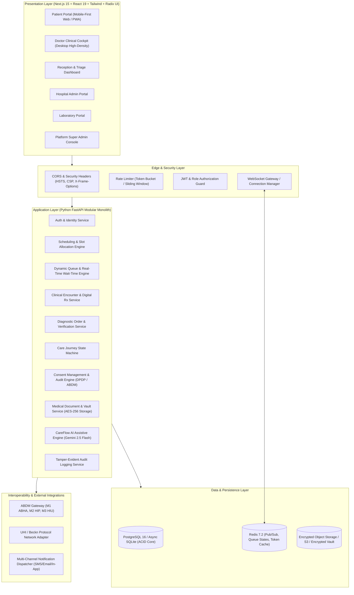
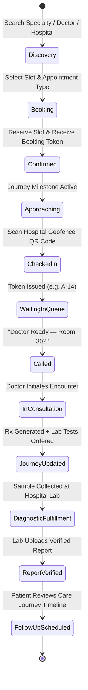
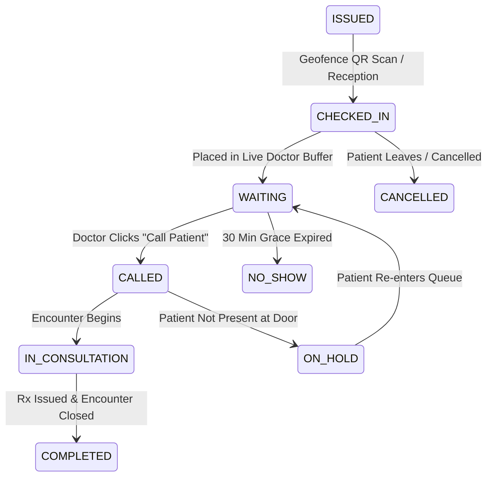
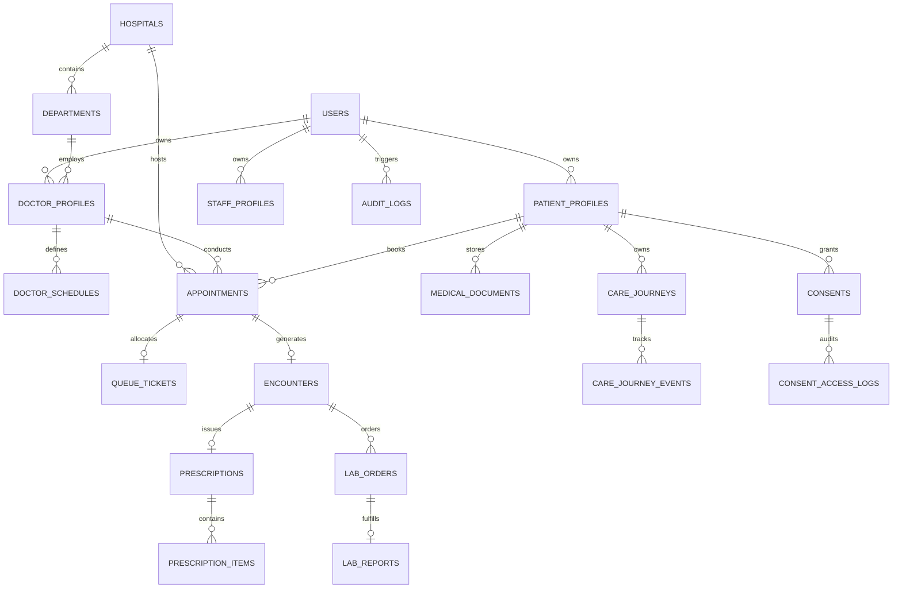
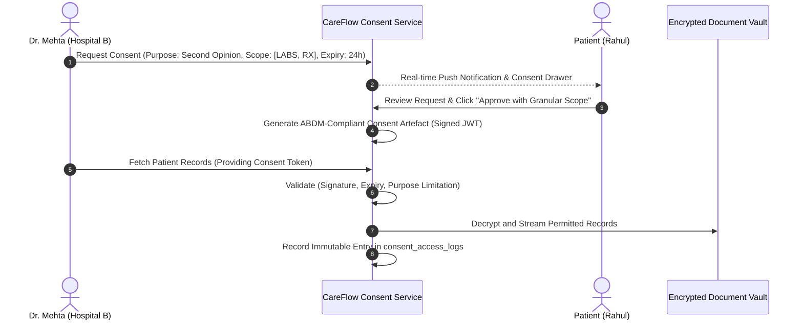
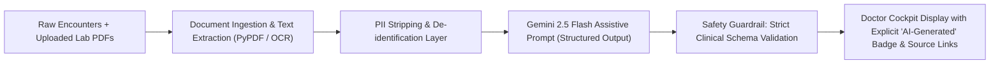

# CAREFLOW — Master Product, Research, Architecture & Engineering Specification

**Document Version:** 1.0.0  
**Status:** Architecture Blueprint & Engineering Baseline  
**Classification:** Healthcare Technology Platform (B2B2C Modular Healthcare Operating Layer)  
**Applicable Standards:** HL7® FHIR® R4 (India NRCeS ABDM Profiles), DPDP Act 2023, Telemedicine Practice Guidelines (NMC), W3C Web Accessibility Guidelines (WCAG 2.1 AA)

---

## Executive Summary

**CareFlow** is an enterprise-grade, consent-driven healthcare journey coordination platform. Unlike legacy doctor-booking aggregators or siloed Hospital Management Information Systems (HMIS), CareFlow unifies the fragmented patient journey across the continuum of care:
$$\text{Discovery} \longrightarrow \text{Booking} \longrightarrow \text{Smart Check-in} \longrightarrow \text{Dynamic Queue} \longrightarrow \text{Clinical Encounter} \longrightarrow \text{Digital Rx} \longrightarrow \text{Lab Orders} \longrightarrow \text{Care Journey} \longrightarrow \text{Consent-based Sharing}$$

The platform is designed as a **modular monolith** engineered for zero-friction local and cloud deployment, strict least-privilege authorization, deterministic queue intelligence, standards-compliant FHIR R4 clinical data models, and safe, assistive clinical AI.

---

## 1. Refined Product Architecture

### 1.1 Architectural Topology



### 1.2 Core Architectural Principles
1. **Separation of Concerns:** Strict domain boundaries (`auth`, `appointments`, `queues`, `consultations`, `prescriptions`, `records`, `consent`, `analytics`).
2. **Deterministic Fallbacks:** The platform operates in fully autonomous standalone mode with simulated ABDM/UHI adapters and in-memory PubSub fallback if external Redis or remote gateways are offline.
3. **Assistive, Non-Prescriptive AI:** Artificial intelligence is strictly sandboxed as an administrative synthesis engine (pre-visit summaries, PDF metadata extraction, patient navigation) with mandatory clinician sign-off.
4. **Least-Privilege RBAC & ABAC:** Access is evaluated on role, organization, assigned encounter, and explicit patient consent artifacts.
5. **Event-Driven Real-Time Sync:** WebSockets broadcast delta state changes to specific topic rooms, eliminating polling overhead.

---

## 2. Complete Feature Map

| Feature Domain | Patient Portal | Doctor Portal | Receptionist Portal | Hospital Admin | Lab Portal | Super Admin |
| :--- | :---: | :---: | :---: | :---: | :---: | :---: |
| **Authentication & RBAC** | ✅ Phone/Email OTP | ✅ Multi-factor | ✅ Role Credential | ✅ Admin Credential | ✅ Lab Credential | ✅ Hardware/MFA |
| **Provider Discovery** | ✅ Multi-Filter Search | ❌ | ❌ | ❌ | ❌ | ❌ |
| **Schedule Engine** | ❌ (View slots) | ❌ (View roster) | ✅ Walk-in Booking | ✅ Slot Templates & Rules | ❌ | ❌ (Global config) |
| **Smart Check-in** | ✅ QR Self-Checkin | ❌ | ✅ Manual Override | ✅ Kiosk Monitor | ❌ | ❌ |
| **Dynamic Queue** | ✅ Live Ticket & ETA | ✅ Call/Hold/Next | ✅ Queue Monitor | ✅ Queue Analytics | ❌ | ✅ System Health |
| **Clinical Encounter** | ❌ | ✅ SOAP Notes | ❌ | ❌ | ❌ | ❌ |
| **Digital Prescription** | ✅ View / PDF Download | ✅ Author & Sign | ❌ | ❌ | ❌ | ❌ |
| **Diagnostic Workflow** | ✅ View Verified Reports | ✅ Order Tests | ❌ | ❌ | ✅ Collect, Upload, Verify | ❌ |
| **Care Journey** | ✅ Timeline & Actions | ✅ Update Milestones | ❌ | ❌ | ✅ Fulfill Orders | ❌ |
| **Consent Management** | ✅ Grant / Revoke / Log | ✅ Request Access | ❌ | ❌ | ❌ | ✅ Policy Audit |
| **Document Vault** | ✅ Upload / Categorize | ✅ Permitted Access | ❌ | ❌ | ✅ Attach Reports | ❌ (Metadata only) |
| **AI Pre-Visit Brief** | ✅ View Plain-English | ✅ Clinical Digest | ❌ | ❌ | ❌ | ❌ |
| **Operational Analytics** | ❌ | ✅ My Consult Metrics | ✅ Daily Headcount | ✅ Wait Times & Loads | ✅ Turnaround Times | ✅ Platform Metrics |
| **Audit & Security** | ✅ Access History | ✅ My Activity Log | ❌ | ✅ Hospital Audit Trail | ❌ | ✅ Global Audit Log |

---

## 3. Detailed User Journeys & State Machines

### 3.1 Patient Journey


### 3.2 Doctor Clinical Cockpit Flow
1. **Morning Briefing:** Doctor logs into high-density workstation; system displays today’s queue roster, breakdown of new consultations vs. follow-ups, and average consultation pace.
2. **Patient Calling:** Doctor clicks **"Call Next Patient"**. WebSocket emits an instantaneous audio-visual push notification to the patient's phone and reception display board.
3. **Clinical Context:** Screen auto-loads:
   - Patient Demographic Header & Allergy Badge.
   - Assistive AI Pre-Visit Brief (condensed from previous encounters and uploaded PDFs).
   - Filtered timeline of permitted historical records (authorized via active appointment or consent artifact).
4. **Encounter Documentation:** Doctor records structured clinical notes using the SOAP standard (Subjective, Objective, Assessment, Plan).
5. **Prescription Authoring:** Structured search for pharmaceutical drugs with strength, formulation, dosage frequency, duration, and patient instructions.
6. **Diagnostic Ordering:** 1-click requisition for laboratory or radiology investigations.
7. **Sign & Conclude:** Doctor cryptographically signs the prescription with their digital key (generating a verifiable SHA-256 HMAC hash and QR verification code). The queue advances automatically.

### 3.3 Reception & Triage Flow
1. **Walk-in Handling:** Quick registration modal capturing patient name, phone, age, gender, and triage priority (Standard, Urgent, Emergency).
2. **Kiosk QR Assistance:** For patients without smartphones, reception prints a physical thermal slip with a QR code and numeric token.
3. **Queue Rebalancing:** Ability to mark patient as "Arrived Late", "On Hold", or "No-Show" after configurable timeout, dynamically updating waiting time estimates for subsequent patients.
4. **Strict Isolation:** Receptionist UI renders *zero* clinical diagnosis fields or prescription records, strictly enforcing HIPAA/DPDP confidentiality.

### 3.4 Hospital Admin Flow
1. **Department & Doctor Management:** Provision departments (Cardiology, Orthopedics, General Medicine), allocate clinical consultation rooms, and assign doctor rosters.
2. **Schedule Engine Rules:** Configure slot granularities (e.g., New: 20 min, Follow-up: 10 min, Procedure: 30 min), buffer intervals (5 min), and emergency slot reserves.
3. **Operations Command Center:** Live dashboard tracking Doctor Utilization Rate, Average Queue Dwell Time, Bottlenecks, and Departmental Load.

### 3.5 Laboratory Workflow
1. **Order Inbox:** Lab technicians view pending diagnostic orders categorized by requisition timestamp and urgency.
2. **Sample Collection:** Scan patient QR token, record sample collection timestamp and specimen ID (Barcoded).
3. **Processing & Verification:** Pathologist reviews numeric assay results, uploads signed PDF report, and marks status as `VERIFIED`.
4. **Event Emission:** Backend updates the patient’s Care Journey node to `COMPLETED`, adds the report to the Medical Document Vault, and triggers real-time alerts to the ordering physician and patient.

### 3.6 Platform Super Admin Flow
1. **Tenant Onboarding:** Multi-tenant provisioning of hospitals with HFR (Health Facility Registry) verification audits.
2. **HPR Verification:** Validation of medical practitioner licenses against National Medical Commission registries.
3. **Platform Telemetry:** Monitoring WebSocket connection health, API latency percentiles (p50, p95, p99), error logs, and security anomaly detection (brute-force login flags, unauthorized record access attempts).
4. **Audit Compliance:** Immutable global audit viewer tracing every cross-tenant data access event.

---

## 4. Dynamic Queue Engine & Wait-Time Algorithm

### 4.1 Mathematical Formulation of Estimated Waiting Time (EWT)

Traditional hospital tokens rely on static multiplying factors ($N \times \text{slot\_duration}$), which catastrophically fail in real clinics where consultation durations vary significantly. CareFlow implements an **Adaptive Exponential Smoothing & Priority Queue Model**:

$$\text{EWT}_i = \sum_{j=1}^{K_i} \hat{D}_{j} + \Delta_{\text{current\_delay}} + \beta \cdot P_{\text{buffer}}$$

Where:
- $K_i$: Number of checked-in patients physically ahead of patient $i$ in the active queue.
- $\hat{D}_{j}$: Predicted duration for patient $j$, calculated via an exponentially weighted moving average (EWMA) of the specific doctor's consultation durations for the specific appointment type:
  $$\hat{D}_{j} = \alpha \cdot \bar{D}_{\text{historical}} + (1 - \alpha) \cdot \bar{D}_{\text{today\_recent}}$$
  (Default smoothing factor $\alpha = 0.35$).
- $\Delta_{\text{current\_delay}}$: Elapsed time of the ongoing consultation exceeding its scheduled slot:
  $$\Delta_{\text{current\_delay}} = \max\left(0, t_{\text{now}} - t_{\text{consultation\_start}} - S_{\text{scheduled}}\right)$$
- $\beta \cdot P_{\text{buffer}}$: Adaptive buffer accounting for no-show probability ($P_{\text{no\_show}} \approx 12\%$) and walk-in triage insertions.

### 4.2 Queue Ticket States


---

## 5. Database Architecture & Entity-Relationship Schema

CareFlow utilizes an enterprise relational schema engineered for PostgreSQL 16 (with full compatibility for Async SQLite in local zero-setup dev environments).



### 5.1 Comprehensive Relational Schema Specifications

1. **`users`**
   - `id`: UUID (PK, Indexed)
   - `email`: VARCHAR(255) (Unique, Nullable)
   - `phone`: VARCHAR(20) (Unique, Indexed)
   - `password_hash`: VARCHAR(255) (Argon2id/bcrypt)
   - `role`: ENUM ('PATIENT', 'DOCTOR', 'RECEPTIONIST', 'LAB_TECH', 'HOSPITAL_ADMIN', 'SUPER_ADMIN')
   - `full_name`: VARCHAR(150) NOT NULL
   - `is_active`: BOOLEAN DEFAULT TRUE
   - `created_at`: TIMESTAMPTZ DEFAULT NOW()

2. **`patient_profiles`**
   - `id`: UUID (PK)
   - `user_id`: UUID (FK -> users.id, Unique)
   - `abha_number`: VARCHAR(17) (Nullable, Unique - Indian ABDM 14-digit identifier)
   - `abha_address`: VARCHAR(100) (Nullable, e.g. "rahul@abdm")
   - `dob`: DATE
   - `gender`: ENUM ('MALE', 'FEMALE', 'OTHER')
   - `blood_group`: VARCHAR(5)
   - `emergency_contact_name`: VARCHAR(100)
   - `emergency_contact_phone`: VARCHAR(20)
   - `allergies`: TEXT[] (Array of known drug/food allergies)
   - `chronic_conditions`: TEXT[]

3. **`hospitals`**
   - `id`: UUID (PK)
   - `hfr_id`: VARCHAR(50) (Health Facility Registry ID)
   - `name`: VARCHAR(200) NOT NULL
   - `slug`: VARCHAR(220) UNIQUE
   - `city`: VARCHAR(100) NOT NULL
   - `state`: VARCHAR(100) NOT NULL
   - `address`: TEXT NOT NULL
   - `latitude`: NUMERIC(10, 7)
   - `longitude`: NUMERIC(10, 7)
   - `qr_checkin_token`: VARCHAR(128) UNIQUE (Geofence QR salt)
   - `is_verified`: BOOLEAN DEFAULT FALSE
   - `is_active`: BOOLEAN DEFAULT TRUE

4. **`departments`**
   - `id`: UUID (PK)
   - `hospital_id`: UUID (FK -> hospitals.id)
   - `name`: VARCHAR(100) NOT NULL (e.g. "Cardiology")
   - `code`: VARCHAR(20) NOT NULL
   - `description`: TEXT

5. **`doctor_profiles`**
   - `id`: UUID (PK)
   - `user_id`: UUID (FK -> users.id, Unique)
   - `hospital_id`: UUID (FK -> hospitals.id)
   - `department_id`: UUID (FK -> departments.id)
   - `hpr_id`: VARCHAR(50) (Healthcare Professional Registry ID)
   - `registration_number`: VARCHAR(50) NOT NULL
   - `qualification`: VARCHAR(150) NOT NULL
   - `specialization`: VARCHAR(100) NOT NULL
   - `experience_years`: INT NOT NULL
   - `consultation_fee`: NUMERIC(10, 2) NOT NULL
   - `room_number`: VARCHAR(30)
   - `languages`: TEXT[]
   - `is_verified`: BOOLEAN DEFAULT FALSE

6. **`doctor_schedules`**
   - `id`: UUID (PK)
   - `doctor_id`: UUID (FK -> doctor_profiles.id)
   - `day_of_week`: INT (0 = Monday, 6 = Sunday)
   - `start_time`: TIME NOT NULL
   - `end_time`: TIME NOT NULL
   - `slot_duration_minutes`: INT DEFAULT 15
   - `buffer_time_minutes`: INT DEFAULT 5
   - `max_patients_per_session`: INT DEFAULT 30
   - `is_active`: BOOLEAN DEFAULT TRUE

7. **`appointments`**
   - `id`: UUID (PK)
   - `booking_reference`: VARCHAR(16) UNIQUE (e.g., "CF-2026-98124")
   - `patient_id`: UUID (FK -> patient_profiles.id)
   - `doctor_id`: UUID (FK -> doctor_profiles.id)
   - `hospital_id`: UUID (FK -> hospitals.id)
   - `appointment_date`: DATE NOT NULL
   - `start_time`: TIME NOT NULL
   - `end_time`: TIME NOT NULL
   - `appointment_type`: ENUM ('NEW_CONSULT', 'FOLLOW_UP', 'REPORT_REVIEW', 'PROCEDURE')
   - `status`: ENUM ('CONFIRMED', 'CHECKED_IN', 'IN_QUEUE', 'IN_CONSULTATION', 'COMPLETED', 'CANCELLED', 'NO_SHOW')
   - `reason_for_visit`: TEXT
   - `created_at`: TIMESTAMPTZ DEFAULT NOW()

8. **`queue_tickets`**
   - `id`: UUID (PK)
   - `appointment_id`: UUID (FK -> appointments.id, Unique)
   - `doctor_id`: UUID (FK -> doctor_profiles.id)
   - `hospital_id`: UUID (FK -> hospitals.id)
   - `ticket_number`: VARCHAR(20) NOT NULL (e.g. "CARD-A12")
   - `sequence_number`: INT NOT NULL
   - `check_in_time`: TIMESTAMPTZ NOT NULL
   - `called_time`: TIMESTAMPTZ
   - `service_start_time`: TIMESTAMPTZ
   - `service_end_time`: TIMESTAMPTZ
   - `state`: ENUM ('CHECKED_IN', 'WAITING', 'CALLED', 'IN_CONSULTATION', 'COMPLETED', 'ON_HOLD', 'NO_SHOW')
   - `estimated_wait_minutes`: INT DEFAULT 0

9. **`encounters`**
   - `id`: UUID (PK)
   - `appointment_id`: UUID (FK -> appointments.id, Unique)
   - `patient_id`: UUID (FK -> patient_profiles.id)
   - `doctor_id`: UUID (FK -> doctor_profiles.id)
   - `subjective`: TEXT (Chief complaints & history of present illness)
   - `objective`: TEXT (Vitals, physical examination)
   - `assessment`: TEXT (Clinical diagnosis / differential diagnosis)
   - `plan`: TEXT (Management plan)
   - `created_at`: TIMESTAMPTZ DEFAULT NOW()

10. **`prescriptions`**
    - `id`: UUID (PK)
    - `encounter_id`: UUID (FK -> encounters.id, Unique)
    - `patient_id`: UUID (FK -> patient_profiles.id)
    - `doctor_id`: UUID (FK -> doctor_profiles.id)
    - `prescription_number`: VARCHAR(32) UNIQUE
    - `digital_signature_hash`: VARCHAR(128) NOT NULL (HMAC-SHA256)
    - `verification_code`: VARCHAR(64) UNIQUE NOT NULL
    - `instructions`: TEXT
    - `follow_up_date`: DATE
    - `created_at`: TIMESTAMPTZ DEFAULT NOW()

11. **`prescription_items`**
    - `id`: UUID (PK)
    - `prescription_id`: UUID (FK -> prescriptions.id, Cascade)
    - `medicine_name`: VARCHAR(200) NOT NULL
    - `generic_name`: VARCHAR(200)
    - `formulation`: ENUM ('TABLET', 'CAPSULE', 'SYRUP', 'INJECTION', 'OINTMENT', 'DROPS', 'INHALER')
    - `dosage`: VARCHAR(50) NOT NULL (e.g. "500 mg")
    - `frequency`: VARCHAR(50) NOT NULL (e.g. "1-0-1 (Twice daily after meals)")
    - `duration_days`: INT NOT NULL
    - `special_instructions`: TEXT

12. **`lab_orders`**
    - `id`: UUID (PK)
    - `encounter_id`: UUID (FK -> encounters.id)
    - `patient_id`: UUID (FK -> patient_profiles.id)
    - `doctor_id`: UUID (FK -> doctor_profiles.id)
    - `test_name`: VARCHAR(200) NOT NULL
    - `test_code`: VARCHAR(50) (LOINC code e.g. "57021-8")
    - `clinical_notes`: TEXT
    - `priority`: ENUM ('ROUTINE', 'URGENT', 'STAT')
    - `status`: ENUM ('ORDERED', 'SAMPLE_COLLECTED', 'PROCESSING', 'VERIFIED', 'CANCELLED')
    - `created_at`: TIMESTAMPTZ DEFAULT NOW()

13. **`lab_reports`**
    - `id`: UUID (PK)
    - `lab_order_id`: UUID (FK -> lab_orders.id, Unique)
    - `patient_id`: UUID (FK -> patient_profiles.id)
    - `verified_by_user_id`: UUID (FK -> users.id)
    - `report_number`: VARCHAR(50) UNIQUE NOT NULL
    - `document_url`: TEXT NOT NULL
    - `file_sha256`: VARCHAR(64) NOT NULL
    - `summary`: TEXT
    - `abnormal_flags`: BOOLEAN DEFAULT FALSE
    - `verified_at`: TIMESTAMPTZ DEFAULT NOW()

14. **`care_journeys`**
    - `id`: UUID (PK)
    - `patient_id`: UUID (FK -> patient_profiles.id)
    - `title`: VARCHAR(200) NOT NULL (e.g. "Hypertension & Cardiac Follow-up")
    - `status`: ENUM ('ACTIVE', 'COMPLETED', 'ARCHIVED')
    - `started_at`: TIMESTAMPTZ DEFAULT NOW()
    - `completed_at`: TIMESTAMPTZ

15. **`care_journey_events`**
    - `id`: UUID (PK)
    - `care_journey_id`: UUID (FK -> care_journeys.id, Cascade)
    - `event_type`: ENUM ('APPOINTMENT_BOOKED', 'CHECKED_IN', 'CONSULTATION_HELD', 'PRESCRIPTION_ISSUED', 'LAB_TEST_ORDERED', 'SAMPLE_COLLECTED', 'LAB_REPORT_READY', 'DOCTOR_REVIEWED', 'CARE_GOAL_MET')
    - `title`: VARCHAR(200) NOT NULL
    - `description`: TEXT
    - `provider_name`: VARCHAR(200)
    - `reference_id`: UUID (Polymorphic pointer to appointment/prescription/report)
    - `status`: ENUM ('PENDING', 'IN_PROGRESS', 'COMPLETED', 'SKIPPED')
    - `next_action_label`: VARCHAR(100)
    - `next_action_url`: VARCHAR(255)
    - `event_timestamp`: TIMESTAMPTZ DEFAULT NOW()

16. **`consents`**
    - `id`: UUID (PK)
    - `consent_artefact_id`: VARCHAR(64) UNIQUE NOT NULL (Compliant with ABDM format)
    - `patient_id`: UUID (FK -> patient_profiles.id)
    - `requester_user_id`: UUID (FK -> users.id)
    - `requester_hospital_id`: UUID (FK -> hospitals.id)
    - `purpose`: ENUM ('CARE_MANAGEMENT', 'SECOND_OPINION', 'DIAGNOSTIC_EVALUATION', 'EMERGENCY')
    - `scopes`: TEXT[] (Array of 'PRESCRIPTIONS', 'LAB_REPORTS', 'CLINICAL_NOTES', 'ALLERGIES')
    - `status`: ENUM ('REQUESTED', 'GRANTED', 'DENIED', 'REVOKED', 'EXPIRED')
    - `valid_from`: TIMESTAMPTZ NOT NULL
    - `valid_to`: TIMESTAMPTZ NOT NULL
    - `created_at`: TIMESTAMPTZ DEFAULT NOW()

17. **`consent_access_logs`**
    - `id`: UUID (PK)
    - `consent_id`: UUID (FK -> consents.id)
    - `accessed_by_user_id`: UUID (FK -> users.id)
    - `resource_accessed`: VARCHAR(100) NOT NULL
    - `ip_address`: VARCHAR(45)
    - `accessed_at`: TIMESTAMPTZ DEFAULT NOW()

18. **`audit_logs`**
    - `id`: UUID (PK)
    - `actor_id`: UUID (FK -> users.id, Nullable)
    - `action`: VARCHAR(100) NOT NULL (e.g. "RECORD_VIEWED", "RX_CREATED", "CONSENT_REVOKED")
    - `resource_type`: VARCHAR(50) NOT NULL
    - `resource_id`: UUID NOT NULL
    - `hospital_id`: UUID (Nullable)
    - `ip_address`: VARCHAR(45)
    - `user_agent`: TEXT
    - `status`: ENUM ('SUCCESS', 'FAILURE', 'DENIED')
    - `details_json`: JSONB
    - `timestamp`: TIMESTAMPTZ DEFAULT NOW()

---

## 6. Frontend Architecture & Screen Hierarchy

The presentation tier is implemented in **Next.js 15 (App Router)** with **TypeScript**, **Tailwind CSS**, and **Lucide Icons** / **Radix UI Primitives**.

### 6.1 Route Topology & Screen Map

```
frontend/src/app/
│
├── (auth)/
│   ├── login/page.tsx               # Unified role-aware authentication
│   └── register/page.tsx            # Patient registration & ABHA creation
│
├── (patient)/
│   ├── layout.tsx                   # Patient layout with bottom navigation bar (Mobile)
│   ├── dashboard/page.tsx           # Home: Upcoming appt, active journey badge, quick actions
│   ├── discover/page.tsx            # Multi-parameter doctor & hospital finder
│   ├── doctors/[id]/page.tsx        # Doctor profile, credential badges, slot selector
│   ├── appointments/
│   │   ├── page.tsx                 # Past & upcoming appointments
│   │   └── [id]/checkin/page.tsx    # Geofence QR check-in & Live Queue ticket card
│   ├── journey/page.tsx             # Visual Care Journey Timeline (Interactive nodes)
│   ├── records/page.tsx             # Medical Document Vault (Prescriptions, Labs, Uploads)
│   ├── consent/page.tsx             # Consent Manager (Pending requests, active grants, audit)
│   └── profile/page.tsx             # Patient ABHA profile, emergency cards, family accounts
│
├── (doctor)/
│   ├── layout.tsx                   # High-density clinical sidebar & quick stats header
│   ├── doctor/dashboard/page.tsx    # Today's roster, active waiting count, quick actions
│   ├── doctor/queue/page.tsx        # Live Queue Cockpit: "Call Next", "In-Consultation"
│   ├── doctor/consultation/[id]/    # SOAP clinical documentation, Rx builder, lab orders
│   └── doctor/patients/[id]/        # Permitted longitudinal records & AI Pre-visit Brief
│
├── (reception)/
│   └── reception/page.tsx           # Kiosk check-in override, walk-in token generator
│
├── (hospital-admin)/
│   ├── hospital/dashboard/page.tsx  # Departmental loads, queue dwell times, wait metrics
│   └── hospital/schedules/page.tsx  # Doctor roster configuration, slot template rules
│
├── (lab)/
│   └── lab/page.tsx                 # Diagnostic order inbox, specimen tracking, report verification
│
├── (platform-admin)/
│   └── admin/dashboard/page.tsx     # Tenant verification, HPR/HFR checks, security audit stream
│
└── verify/
    └── rx/[code]/page.tsx           # Public cryptographic prescription verification portal
```

### 6.2 Design System Tokens & UX Principles
- **Color Semantics:** Clinical Emerald (`#059669`) for positive health progression and verified credentials; Medical Cyan (`#0284C7`) for system navigation and appointments; Alert Amber (`#D97706`) for approaching queue calls; Emergency Red (`#DC2626`) for allergies and critical triage.
- **Cognitive Simplicity:** The patient home screen shows a maximum of **3 primary choices**: (1) Active Care Card / Queue Status, (2) Book Care, (3) My Health Records.
- **Instantaneous Feedback:** Optimistic UI state transitions with immediate audio/visual tactile cues upon token advancement.

---

## 7. Backend Architecture & Service Layer

The backend is structured as a **Modular Monolith** using **Python FastAPI** and **Async SQLAlchemy 2.0**.

```
backend/
├── app/
│   ├── main.py                     # ASGI application factory & lifespan manager
│   ├── core/
│   │   ├── config.py               # Pydantic Settings (Environment variables)
│   │   ├── database.py             # Async engine, sessionmaker, base model
│   │   ├── security.py             # Argon2id hashing, JWT access/refresh token handlers
│   │   ├── websocket_manager.py    # In-memory / Redis pubsub room broadcaster
│   │   └── audit.py                # Interceptor & decorator for tamper-evident audit logs
│   ├── api/
│   │   └── v1/
│   │       ├── api.py              # Central router aggregating domain endpoints
│   │       └── endpoints/
│   │           ├── auth.py         # Login, token refresh, OTP simulator
│   │           ├── discovery.py    # Search doctors and hospitals with slot availability
│   │           ├── appointments.py # Booking, cancellation, reschedule
│   │           ├── queue.py        # Check-in, live status, call-next, wait-time prediction
│   │           ├── encounters.py   # Clinical consultation, SOAP documentation
│   │           ├── prescriptions.py# Rx creation, cryptographic signing, PDF generation
│   │           ├── lab.py          # Lab orders, sample updates, PDF report verification
│   │           ├── journey.py      # Care journey state machine transitions & queries
│   │           ├── consent.py      # Consent request, grant, revoke, access evaluation
│   │           ├── records.py      # Document metadata, signed upload/download URLs
│   │           ├── ai.py           # Gemini 2.5 Flash pre-visit brief & document extraction
│   │           └── admin.py        # Analytics, tenant onboarding, audit log stream
│   ├── models/                     # SQLAlchemy declarative ORM models
│   ├── schemas/                    # Pydantic v2 validation and serialization schemas
│   ├── services/                   # Core business logic isolated from HTTP transport
│   │   ├── scheduling_service.py   # Conflict detection, slot generation, buffer calculus
│   │   ├── queue_service.py        # EWMA wait-time estimation, state transitions
│   │   ├── crypto_service.py       # HMAC-SHA256 signature and QR code generator
│   │   └── ai_brief_service.py     # Deterministic prompt construction with safety filters
│   └── integrations/
│       ├── abdm_adapter.py         # NRCeS FHIR R4 Bundle generator & M1-M3 mock adapter
│       └── storage_adapter.py      # Encrypted local/S3 signed object storage driver
```

---

## 8. Real-Time WebSocket Communication Specification

To eliminate continuous polling, CareFlow provides a unified WebSocket gateway at `/api/v1/ws/stream`.

### 8.1 Subscription Protocol
Upon establishing the connection, the client authenticates using their Bearer JWT:
```json
{
  "action": "SUBSCRIBE",
  "token": "eyJhbGciOi...",
  "rooms": ["hospital:H1:queue", "doctor:D4:queue", "patient:P10:journey"]
}
```

### 8.2 Broadcast Events
1. **`QUEUE_POSITION_UPDATED`**: Emitted when a patient ahead is completed or called.
   ```json
   {
     "event": "QUEUE_POSITION_UPDATED",
     "data": {
       "ticket_number": "CARD-A14",
       "patients_ahead": 3,
       "estimated_wait_minutes": 18,
       "doctor_status": "IN_CONSULTATION"
     }
   }
   ```
2. **`PATIENT_CALLED`**: Emitted to the specific patient and reception board.
   ```json
   {
     "event": "PATIENT_CALLED",
     "data": {
       "ticket_number": "CARD-A14",
       "room": "Room 302",
       "doctor_name": "Dr. Ananya Sharma",
       "message": "Please proceed to Room 302 for your consultation."
     }
   }
   ```
3. **`CARE_JOURNEY_NODE_UPDATED`**: Emitted when lab report is ready or prescription is issued.
   ```json
   {
     "event": "CARE_JOURNEY_NODE_UPDATED",
     "data": {
       "journey_id": "8f9a2e...",
       "event_type": "LAB_REPORT_READY",
       "title": "Lipid Profile Verified",
       "next_action": "Schedule Doctor Review"
     }
   }
   ```

---

## 9. Authentication & Least-Privilege Authorization

### 9.1 Authentication Architecture
- **Dual-Token Architecture:** 
  - `access_token`: Short-lived (15 minutes), containing user ID, role, and tenant ID.
  - `refresh_token`: Long-lived (7 days), stored in an `HttpOnly`, `SameSite=Strict`, `Secure` cookie with database-backed token rotation and immediate invalidation on logout.
- **Password Protection:** Argon2id with 64MB memory cost, 3 iterations, and 4 degrees of parallelism.

### 9.2 Comprehensive Role-Based & Resource-Level Permission Matrix

| Role | Appointments | Queue | Clinical Notes | Prescriptions | Lab Orders | Lab Reports | Consent | Admin Config | Audit Logs |
| :--- | :---: | :---: | :---: | :---: | :---: | :---: | :---: | :---: | :---: |
| **PATIENT** | Create / Own Read / Cancel | Own Read / QR Check-in | ❌ Direct | Own Read / Download | Own Read | Own Read / Download | Grant / Revoke / View | ❌ | Own Access History |
| **DOCTOR** | Read Assigned | Advance / Call / Hold | Create / Read Assigned | Author / Sign / View | Order / Read | Read Permitted | Request / Read Granted | ❌ | Own Activity Log |
| **RECEPTIONIST** | Create Walk-in / Reschedule | Manual Check-in / Reorder | ❌ (Strictly Blocked) | ❌ (Strictly Blocked) | ❌ | ❌ | ❌ | ❌ | ❌ |
| **LAB_TECH** | ❌ | ❌ | ❌ | ❌ | Read / Update Status | Upload / Verify | ❌ | ❌ | ❌ |
| **HOSPITAL_ADMIN** | Read Aggregated | Read Analytics | ❌ (No clinical text) | ❌ (No clinical text) | ❌ | ❌ | ❌ | Full Hospital Scope | Hospital Scope Only |
| **SUPER_ADMIN** | ❌ (No PHI access) | System Metrics | ❌ (No PHI access) | ❌ (No PHI access) | ❌ | ❌ | Policy Compliance | Global Tenant Scope | Full Immutable Stream |

---

## 10. Consent Management & Longitudinal Health Records

CareFlow implements the **Electronic Consent Framework** mandated by the Indian National Digital Health Blueprint (NDHB) and the **Digital Personal Data Protection (DPDP) Act 2023**.



### 10.1 Consent Artifact Attributes
- **Data Fiduciary:** Hospital / Doctor requesting access.
- **Data Principal:** The Patient (identified by ABHA / UUID).
- **Purpose Specification:** Clinical Consultation, Second Opinion, or Diagnostic Evaluation.
- **Granular Categories:** `PRESCRIPTIONS`, `DIAGNOSTIC_REPORTS`, `DISCHARGE_SUMMARIES`, `OPD_NOTES`.
- **Temporal Validity:** Explicit Start and Expiration Timestamps (Strict maximum 72 hours for acute encounters).
- **Revocability:** Patient can revoke active consent at any instant via a 1-click toggle, immediately invalidating access tokens.

---

## 11. Assistive AI Engine & Clinical Safety Boundaries

### 11.1 Assistive Scopes vs. Strict Prohibitions
To uphold patient safety and prevent algorithmic harm:

| Strictly Allowed Assistive Capabilities | Strictly Prohibited System Behaviors |
| :--- | :--- |
| ✅ Pre-Visit Brief synthesizing past visit dates, primary complaints, and recent lab flags | ❌ AI generating clinical diagnoses or differential diagnostic decisions |
| ✅ Plain-language explanations of medical terminology (e.g., explaining what "Lipid Profile" measures) | ❌ AI modifying, calculating, or suggesting pharmaceutical drug dosages |
| ✅ Structured OCR extraction of dates, test names, and numeric results from uploaded lab PDFs | ❌ AI overwriting or modifying signed medical documentation |
| ✅ Administrative navigation ("Where is my appointment? What do I need to bring?") | ❌ AI interacting directly with patients without clinician intermediation on diagnostic matters |

### 11.2 Pre-Visit Brief Synthesis Pipeline



#### System Prompt Template for Pre-Visit Briefing:
```
You are CareFlow Clinical Assistant, an administrative healthcare data synthesis tool.
CRITICAL MANDATES:
1. You MUST NEVER diagnose conditions, recommend therapies, or alter medication dosages.
2. Synthesize ONLY the provided verified consultation notes and lab records.
3. Organize output into:
   - Chronic Conditions & Known Allergies (as explicitly documented)
   - Recent Consultations Timeline
   - Diagnostic Investigations & Notable Numeric Markers
4. For every statement, cite the exact source document ID.
5. If data is missing or ambiguous, explicitly state: "Information not documented in available records."
```

---

## 12. Interoperability & Standards Compliance (ABDM & FHIR R4)

CareFlow aligns with the **National Resource Centre for EHR Standards (NRCeS)** FHIR R4 Implementation Guide for India:
- **FHIR Bundle Type:** `document` (for Prescriptions and Diagnostic Reports).
- **Patient Resource:** Mapped to ABHA Number and ABHA Address.
- **Practitioner Resource:** Mapped to National Medical Commission HPR-ID.
- **Organization Resource:** Mapped to National Health Authority HFR-ID.
- **MedicationRequest Resource:** Standardized with SNOMED CT / Indian Pharmacopoeia naming conventions.
- **DiagnosticReport Resource:** Standardized with LOINC test codes.

---

## 13. Security, Privacy & Tamper-Evident Verification

1. **Cryptographic Prescription Verification:**
   Every digital prescription generated by CareFlow includes a tamper-evident digital seal:
   $$\text{Seal} = \text{HMAC-SHA256}\left(\text{PrescriptionID} \parallel \text{DoctorHPR} \parallel \text{PatientABHA} \parallel \text{Timestamp} \parallel \text{RxItemsHash}, K_{\text{hospital}}\right)$$
   Anyone scanning the QR code on the prescription PDF reaches `/verify/rx/{code}`, which recalculates and validates the cryptographic seal against the database ledger, guaranteeing the document has not been altered post-issuance.
2. **Object Storage Encryption:**
   All uploaded medical documents are encrypted at rest using **AES-256-GCM**. Files are never served via public URLs; access is granted exclusively through short-lived (60-second) HMAC-signed URLs authorized against active consent rules.
3. **IDOR & Parameter Tampering Prevention:**
   All API routes validate that the authenticated user owns the resource or holds an active, verified appointment or consent grant. Request parameters (`patient_id`, `doctor_id`) are never trusted from the client payload.

---

## 14. Hackathon MVP vs. Production Roadmap

```
Phase 1: Hackathon MVP (The "Unbroken Healthcare Journey")
├── [x] Multi-Role Authentication (Patient, Doctor, Receptionist, Hospital Admin, Super Admin)
├── [x] Doctor & Hospital Discovery with Department & Specialty Filtering
├── [x] Dynamic Slot Scheduling Engine
├── [x] QR Code Self Check-in with Hospital Geofencing Simulator
├── [x] Real-time Dynamic Queue Engine with EWMA Wait-Time Calculator
├── [x] WebSocket Multi-Screen Synchronization (Patient, Doctor, Reception)
├── [x] Doctor Clinical Cockpit (SOAP Notes, Structured Rx Authoring, Lab Ordering)
├── [x] Verifiable Cryptographic Prescription with Public QR Verification Portal
├── [x] Diagnostic Laboratory Portal (Specimen Collection & Report Upload)
├── [x] End-to-End Care Journey Interactive Timeline
├── [x] DPDP/ABDM Consent Management with 1-Click Revocation & Access Log
├── [x] Assistive AI Pre-Visit Brief powered by Gemini 2.5 Flash
└── [x] Deterministic Queue Simulation Engine for flawless live judge demos

Phase 2: Post-Hackathon Production Extensions
├── [ ] Native ABDM Gateway M1/M2/M3 Sandbox Certification
├── [ ] UHI Beckn Protocol Network BAP/BPP Endpoints
├── [ ] Pharmacy Inventory & E-Prescription Dispensation Network
├── [ ] Telemedicine WebRTC Encrypted Video Consultations
├── [ ] Automated Insurance Pre-Authorization & Cashless Claims Engine
└── [ ] Native iOS/Android React Native Client Apps
```

---

## 15. The 4-Minute Unbroken Hackathon Demo Story

To deliver maximum impact for hackathon judges, CareFlow demonstrates **three synchronized screens simultaneously**:
1. **Screen 1 (Left - Mobile Aspect Ratio):** Patient Portal (Rahul Verma).
2. **Screen 2 (Center - Desktop 1080p):** Doctor Clinical Cockpit (Dr. Ananya Sharma - Cardiology).
3. **Screen 3 (Right - Tablet Aspect Ratio):** Hospital Live Queue Board & Receptionist Kiosk.

### Demo Script Timeline
- **Minute 0:00 - 0:45 (The Problem & Discovery):**
  Show the patient booking an appointment with Dr. Sharma for cardiac evaluation. Slot is confirmed in 2 clicks. The Care Journey initializes: Node 1 "Appointment Confirmed".
- **Minute 0:45 - 1:30 (Smart Check-in & Dynamic Queue):**
  Patient arrives at the hospital, clicks "Scan Hospital QR". Instantly, Token **CARD-A14** is issued. The screen updates: *"3 patients ahead | Est. Wait: 18 mins"*. Simultaneously, the Doctor Cockpit and Reception Board refresh in real-time via WebSockets without any page reload.
- **Minute 1:30 - 2:45 (The Clinical Encounter & AI Brief):**
  Doctor clicks "Call Patient". Patient's phone vibrates and alerts "Proceed to Room 302". Doctor reviews the **AI Pre-Visit Brief** (synthesized from Rahul's past records). Doctor records clinical findings, authors a digital prescription, and orders a Lipid Profile test. Doctor cryptographically signs the prescription.
- **Minute 2:45 - 3:30 (Lab Fulfillment & Care Journey Propagation):**
  Switch to the Lab Portal: Technician marks sample collected and uploads a verified Lipid Profile report. Instantly, the Patient's **Care Journey** updates: Consultation (Done), Prescription (Done), Lab Test (Verified). Patient downloads the prescription and scans the QR code to show the live verification certificate.
- **Minute 3:30 - 4:00 (Consent-Driven Second Opinion & Operational Metrics):**
  Patient receives a consent request from Dr. Mehta for a second opinion, grants 24-hour access, and views the immediate audit record in Access History. Finish on the Hospital Admin Dashboard showing real-time queue dwell time metrics.

---

## 16. Development Milestones & Implementation Blueprint

- **M01 — Workspace & Foundation Setup:** Git setup, monorepo directory layout, FastAPI ASGI shell, Next.js 15 skeleton with Tailwind and Lucide.
- **M02 — Database & ORM Engine:** Async SQLAlchemy models, Alembic migrations, PostgreSQL & SQLite compatibility layer.
- **M03 — Authentication & RBAC Core:** Argon2id hashing, dual JWT issuance, role-based middleware guards.
- **M04 — Realistic Demo Data Seeder:** 3 hospitals, 6 departments, 12 doctors, 8 patients, historical encounters, and sample clinical documents.
- **M05 — Provider Discovery & Scheduling Engine:** Multi-parameter search, slot generation, buffer calculation, and conflict-free booking.
- **M06 — Check-in & Dynamic Queue Engine:** QR token generation, EWMA wait-time estimation, ticket lifecycle state machine.
- **M07 — Real-Time WebSocket Infrastructure:** Topic-based room broadcaster with reconnection backoff.
- **M08 — Doctor Clinical Cockpit & SOAP Engine:** High-density clinical UI, past record timeline, consultation notes.
- **M09 — Cryptographic Prescription Engine:** Structured Rx builder, HMAC-SHA256 signing, PDF rendering, public QR verification.
- **M10 — Laboratory Diagnostic Portal:** Order inbox, specimen state management, report upload, and SHA-256 integrity hashing.
- **M11 — Visual Care Journey State Machine:** Interactive timeline, next-best-action logic, polymorphic event linkages.
- **M12 — DPDP/ABDM Consent Management:** Granular consent request, approve/revoke toggles, and immutable access audit logs.
- **M13 — Assistive AI Pre-Visit Brief:** Gemini 2.5 Flash integration with structured output schemas and clinical safety filters.
- **M14 — Hospital Operations & Reception Dashboard:** Walk-in kiosk, queue reordering, and live operational throughput analytics.
- **M15 — Deterministic Queue Simulation Engine:** Automated background driver for live multi-screen judge demonstrations.
- **M16 — Comprehensive Testing & Verification:** End-to-end integration tests, IDOR security tests, and performance validation.

---

## 17. Risk Analysis & Mitigation Matrix

| Risk Domain | Potential Vulnerability / Failure Mode | Architectural Mitigation in CareFlow |
| :--- | :--- | :--- |
| **Clinical Safety** | AI hallucinating a clinical diagnosis or contraindicating medication. | Strict prompt sandboxing; AI restricted to administrative summarization; mandatory physician signature on all outputs. |
| **Data Privacy (DPDP)** | Doctor accessing patient records without legitimate clinical cause. | Least-privilege authorization; access requires active appointment or valid, unexpired patient consent artifact; all access audited. |
| **Concurrency / Booking** | Two patients booking the exact same doctor slot simultaneously. | Database-level row locking (`SELECT ... FOR UPDATE`) and unique constraints on `(doctor_id, appointment_date, start_time)`. |
| **Real-Time Reliability** | WebSocket disconnects during network drop in hospital basements. | Client auto-reconnect with exponential backoff and transparent HTTP polling fallback with last-event-ID sync. |
| **Document Integrity** | Malicious tampering with digital prescription PDFs post-consultation. | HMAC-SHA256 digital signature recorded in database and validated via public QR verification portal. |
| **Demo Vulnerability** | Live external network failure or rate limit during hackathon judging. | Fully deterministic local demo mode with seeded data, offline simulation engine, and zero external cloud dependencies. |

---

## 18. Critical Evaluation: Weaknesses & Unrealistic Assumptions in Initial Specs

In acting as Principal Healthcare Architect, we identified the following critical vulnerabilities and unrealistic assumptions in the original specification, along with our technically justified improvements:

1. **Weakness: Simplistic Queue Wait-Time Assumptions ($N \times \text{duration}$)**
   - *Issue:* Real consultations rarely adhere to fixed durations. New patients, complications, or elderly patients frequently cause major delays. A static calculation leads to frustrated patients and missed turns.
   - *CareFlow Improvement:* Implemented an **Adaptive Exponentially Weighted Moving Average (EWMA)** algorithm combining the doctor's historical pace with today's real-time consultation duration, factoring in current consultation overruns and buffer coefficients.
2. **Weakness: Unclear Legal Validity of Digital Prescriptions**
   - *Issue:* Generating an unauthenticated PDF and calling it a "digital prescription" violates medical-legal standards under the National Medical Commission (NMC) Telemedicine Practice Guidelines.
   - *CareFlow Improvement:* Added a **tamper-evident HMAC-SHA256 cryptographic seal** linking doctor credentials, patient ID, timestamp, and medication hash, accompanied by a public verification portal (`/verify/rx/{code}`) that inspects the database ledger.
3. **Weakness: Blanket Access for Doctors & Admins**
   - *Issue:* Many systems assume any doctor or administrator can view any patient's records. This violates India's DPDP Act 2023, HIPAA, and GDPR.
   - *CareFlow Improvement:* Implemented **Contextual Dynamic Access Control (CDAC)**. A doctor can *only* access records if: (a) There is an active checked-in appointment today, or (b) An explicit, unexpired consent artifact exists. Hospital admins have *zero* access to clinical notes.
4. **Weakness: Over-reliance on AI in Healthcare Workflows**
   - *Issue:* Allowing AI to draft clinical plans without strict fences risks hallucinations and liability.
   - *CareFlow Improvement:* Sandboxed AI exclusively into an **Assistive Pre-Visit Synthesis Engine**. The AI cannot diagnose, prescribe, or alter text. It extracts structured facts and always displays source document citations.
5. **Weakness: Fragile Microservices for Hackathon Execution**
   - *Issue:* Breaking a hackathon prototype into 8 separate microservices introduces networking failures, orchestration overhead, and debugging complexity.
   - *CareFlow Improvement:* Architected as a **High-Cohesion Modular Monolith**. All modules communicate through clean in-memory interfaces in development, but preserve strict domain boundaries that allow microservice extraction in production.
